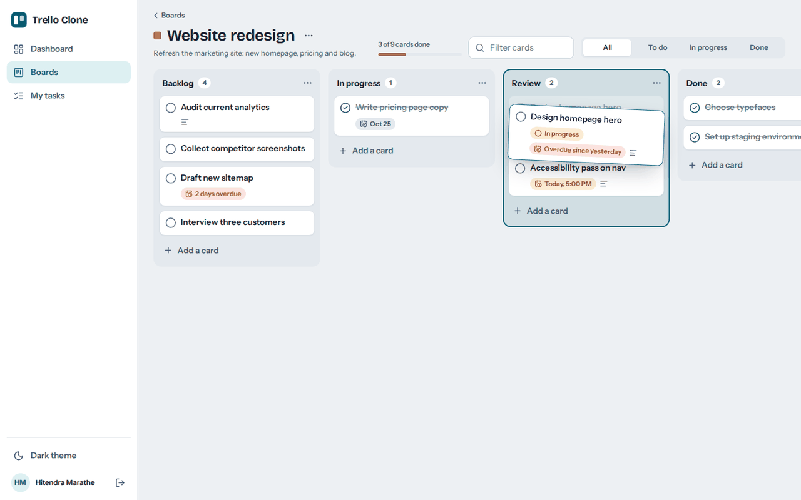
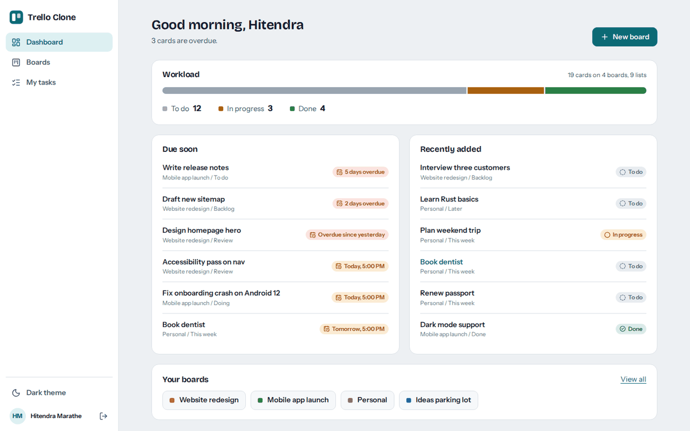
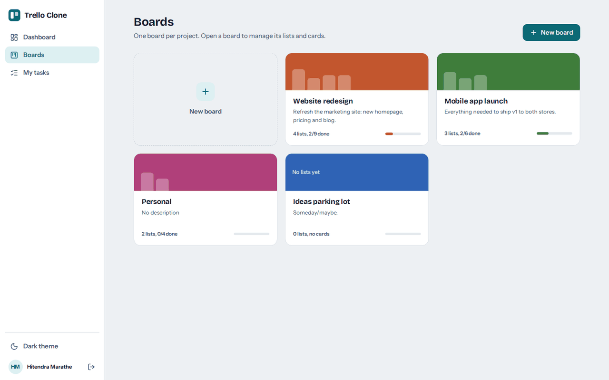
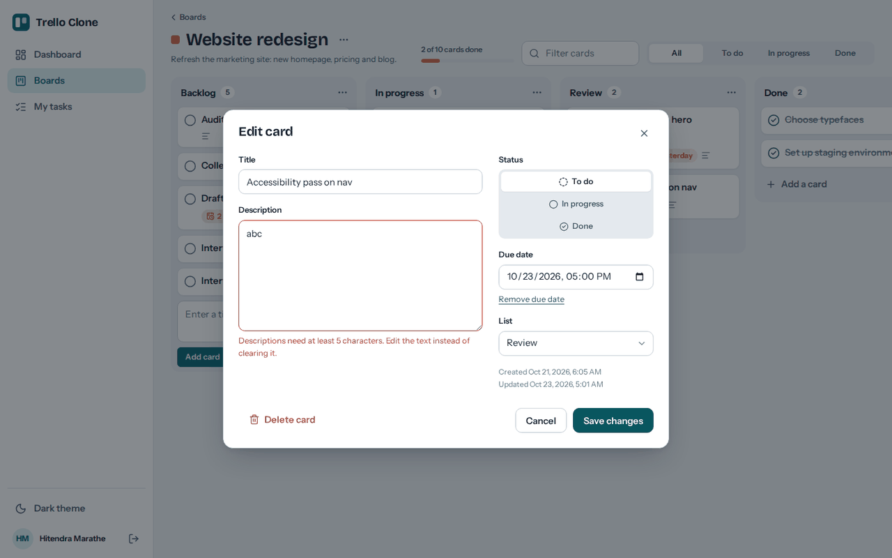
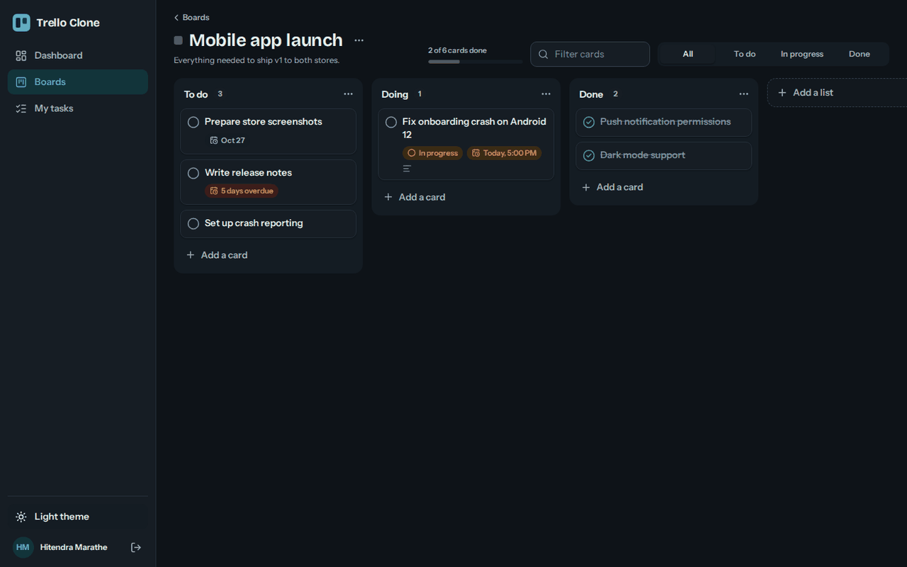
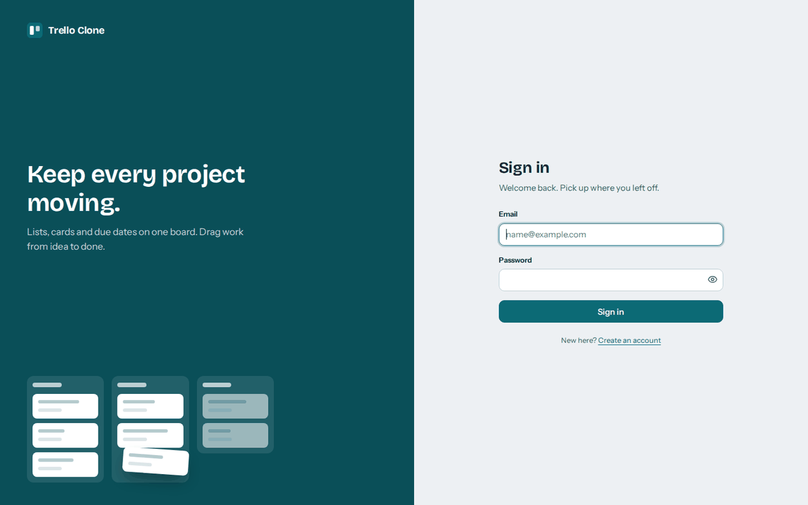
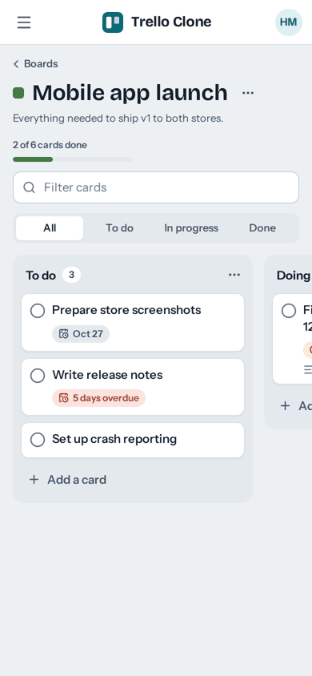

# Trello Clone

A full-stack, Trello-style Kanban task manager. A **Django REST Framework** API with JWT authentication powers a **React** single-page app where you organise work into boards, lists and cards, and drag cards between lists.

**Live Demo:** [Trello Clone](https://trello-clone-frontend-wx9o.onrender.com)

**Backend API:** [Django REST API](https://trello-clone-api-os77.onrender.com)

**API Documentation:** [Swagger UI](https://trello-clone-api-os77.onrender.com/api/schema/swagger-ui/)

**GitHub Repository:** [Hitendra15/trello-clone-api](https://github.com/Hitendra15/trello-clone-api)



## Highlights

- **Kanban boards** with lists and cards, drag-and-drop between lists (mouse and touch), optimistic updates with automatic rollback if the API rejects a change.
- **Cards** with status (To do / In progress / Done), due dates with overdue and due-soon indicators, descriptions, and a one-click "mark as done".
- **Dashboard** with a workload summary, cards due soon and recently added cards.
- **My tasks** page driven by the API's own search, status filter, ordering and pagination. Filters live in the URL, so a view can be bookmarked.
- **Secure by default on the client**: JWT access tokens are refreshed silently, and the session ends cleanly if the refresh token expires.
- **Light and dark themes**, responsive down to phones, keyboard-accessible dialogs and visible focus states.
- **Documented API**: OpenAPI schema with Swagger UI and ReDoc, plus a Postman collection.
- **Live deployment**: React frontend and Django REST API deployed separately on Render.
- **Production database**: PostgreSQL hosted on Neon, with SQLite available for local development.

## Live Deployment

The application is deployed using Render for hosting and Neon for the production PostgreSQL database.

| Component | Service | URL |
| --- | --- | --- |
| Frontend | Render Static Site | [Open application](https://trello-clone-frontend-wx9o.onrender.com) |
| Backend API | Render Web Service | [Open API](https://trello-clone-api-os77.onrender.com) |
| API documentation | Django REST Framework / Swagger UI | [View API docs](https://trello-clone-api-os77.onrender.com/api/schema/swagger-ui/) |
| Database | Neon PostgreSQL | Connected to the deployed backend |

### Production Configuration

- The frontend is built with Vite and deployed as a Render Static Site.
- The backend runs Django with Gunicorn on Render.
- PostgreSQL is used for production data storage through Neon.
- Database migrations run during backend startup.
- The frontend uses the `VITE_API_URL` environment variable to communicate with the backend API.
- Django CORS settings allow requests from the deployed frontend origin.

> **Note:** Render's free web services may spin down after inactivity, so the first request after a period of inactivity can take longer to respond.

## Screenshots

| Dashboard | Boards |
| --- | --- |
|  |  |

| Card editor | Dark theme |
| --- | --- |
|  |  |

| Sign in | Mobile |
| --- | --- |
|  |  |

## Tech Stack

| Layer | Technology |
| --- | --- |
| Backend | Python 3.11+, Django 5.2, Django REST Framework |
| Authentication | Simple JWT |
| API filtering | django-filter |
| CORS | django-cors-headers |
| API documentation | drf-spectacular, OpenAPI 3, Swagger UI, ReDoc |
| Database — development | SQLite |
| Database — production | PostgreSQL hosted on Neon |
| Frontend | React 19, Vite, React Router 7 |
| UI | Hand-written CSS with design tokens, `@dnd-kit/core` for drag and drop, `lucide-react` icons, `sonner` toasts |
| Fonts | Bricolage Grotesque and Instrument Sans via Fontsource |
| Python dependency management | [uv](https://docs.astral.sh/uv/) |
| Frontend dependency management | npm |
| API testing | Postman |
| Deployment | Render and Neon |

## Project Structure

```text
trello-clone-api/
├── account/             # Custom email-based User, register / login / profile / dashboard
├── board/               # Board model + viewset, board -> lists endpoint
├── list/                # List model + viewset, list -> tasks endpoint, ownership permission
├── task/                # Task model + viewset, search / filter / ordering, mark_done action
├── my_trello/           # Settings, root URLs, response-envelope renderer
├── postman/             # Postman collection
├── docs/screenshots/    # Images used in this README
├── frontend/            # React app (see frontend/README.md)
│   └── src/
│       ├── api/         # Fetch client, envelope, errors, token refresh, pagination + endpoints
│       ├── auth/        # AuthContext: session restore, sign in / up / out
│       ├── components/  # AppShell, modals, Kanban column and card
│       ├── pages/       # Login, Register, Dashboard, Boards, Board, Tasks
│       └── styles/      # Tokens (light/dark), base UI kit, layout, board
├── manage.py
├── pyproject.toml
└── uv.lock
```

## Data Model

```text
User ─┬─ Board ─┬─ List ─┬─ Task
      │         │        └─ title, description, status, due_date
      │         └─ title, description
      └─ name, description, is_active
```

A user owns many boards, a board has many lists, and a list has many tasks. Deleting a parent cascades to its children.

## Getting Started

### Prerequisites

- Python 3.11 or newer and [uv](https://docs.astral.sh/uv/getting-started/installation/)
- Node.js 20.19+ (or 22+) and npm

### 1. Clone the Repository

```bash
git clone https://github.com/Hitendra15/trello-clone-api.git
cd trello-clone-api
```

### 2. Run the API Locally

Install the Python dependencies and apply database migrations:

```bash
uv sync
uv run python manage.py migrate
uv run python manage.py runserver
```

The local API is available at:

- API: http://127.0.0.1:8000/api/
- Swagger UI: http://127.0.0.1:8000/api/schema/swagger-ui/
- ReDoc: http://127.0.0.1:8000/api/schema/redoc/

The local development setup uses SQLite unless your Django settings are configured to use another database.

### 3. Run the Frontend Locally

Open a second terminal:

```bash
cd frontend
npm install
```

Create a `.env` file in the `frontend` directory for the local API:

```env
VITE_API_URL=http://127.0.0.1:8000/api
```

Start the development server:

```bash
npm run dev
```

Open http://localhost:5173, create an account, and make your first board.

CORS is configured for `http://localhost:5173` and `http://127.0.0.1:5173`. If you serve the frontend from another origin, add it to `CORS_ALLOWED_ORIGINS` in `my_trello/settings.py`.

## Frontend Scripts

Run these commands from the `frontend` directory.

| Command | What it does |
| --- | --- |
| `npm run dev` | Start the Vite development server with hot reload |
| `npm run build` | Create the production build in `frontend/dist` |
| `npm run preview` | Serve the production build locally |

## Environment Configuration

| Variable | Where | Purpose |
| --- | --- | --- |
| `VITE_API_URL` | `frontend/.env` or Render environment settings | Base URL of the backend API |
| `VITE_API_URL` | `frontend/.env.production` (if maintained) | Production API URL used by the Vite build |
| `SECRET_KEY` | Backend environment settings | Django secret key; keep it private |
| `DEBUG` | Backend environment settings | Controls Django debug mode |
| `ALLOWED_HOSTS` | Backend environment settings | Hosts Django is allowed to serve |
| Database connection variable(s) | Backend environment settings | Connect Django to the production PostgreSQL database |

The deployed frontend uses:

```env
VITE_API_URL=https://trello-clone-api-os77.onrender.com/api
```

Configure the same value in the Render frontend service's environment settings. Vite environment variables are embedded into the frontend at build time, so rebuild and redeploy the frontend after changing them.

**Important:** Never commit production secrets, database credentials, or private environment files to GitHub. Keep `.env.example` for documenting variable names and safe example values.

## API Overview

All responses are wrapped in a consistent envelope:

```json
{
  "success": true,
  "message": "Request successful",
  "errors": null,
  "data": {}
}
```

Errors set `success: false` and put the validation details in `errors`. List endpoints are paginated (10 per page) and return `data: { count, next, previous, results }`.

Send the access token on every protected request:

```http
Authorization: Bearer <access_token>
```

Access tokens last 10 minutes; refresh tokens last 1 day and are rotated on use.

| Area | Method and path | Notes |
| --- | --- | --- |
| Auth | `POST /api/register/` | Returns tokens, so the user is signed in immediately |
| | `POST /api/login/` | Email and password, returns `token.access` and `token.refresh` |
| | `POST /api/auth/token/` | Standard Simple JWT token pair |
| | `POST /api/auth/token/refresh/` | Exchange a refresh token for a new access token |
| | `GET /api/profile/` | Current user's name |
| | `GET /api/dashboard/` | Totals, task counts by status, and the user's boards |
| Boards | `GET, POST /api/boards/` | List or create boards |
| | `GET, PUT, PATCH, DELETE /api/boards/<id>/` | Retrieve, update, or delete a board |
| | `GET, POST /api/boards/<id>/lists/` | Lists of a board (`board` is also required in the POST body) |
| Lists | `GET, POST /api/lists/` | List or create lists |
| | `GET, PUT, PATCH, DELETE /api/lists/<id>/` | Retrieve, update, or delete a list |
| | `GET, POST /api/lists/<id>/tasks/` | Tasks of a list (`list` is also required in the POST body) |
| Tasks | `GET, POST /api/tasks/` | Supports `?search=`, `?status=`, `?ordering=due_date\|created_at` (prefix `-` for descending), and `?page=` |
| | `GET, PUT, PATCH, DELETE /api/tasks/<id>/` | Retrieve, update, or delete a task |
| | `POST /api/tasks/<id>/mark_done/` | Sets the status to `done` |
| | `GET /api/tasks/completed_task/` | All completed tasks (not paginated) |
| Docs | `GET /api/schema/` | OpenAPI schema |
| | `GET /api/schema/swagger-ui/` | Swagger UI |
| | `GET /api/schema/redoc/` | ReDoc |

Validation rules enforced by the API: task titles need at least 2 characters, descriptions at least 5 (when provided), and due dates cannot be in the past.

## How the Frontend Uses the API

- **One client, one place for protocol details.** `frontend/src/api/http.js` unwraps the response envelope, normalises the different error shapes DRF and Simple JWT produce into `{ message, fields }`, and attaches the bearer token.
- **Silent token refresh.** On a `401`, the client refreshes the access token once (concurrent requests share a single refresh call), then replays the request. If the refresh fails, the user is returned to the sign-in screen.
- **Pagination handled for you.** `fetchAll` reads page 1, then fetches the remaining pages in parallel, so boards with more than 10 lists or cards render completely.
- **Optimistic UI.** Moving a card or toggling done updates the screen immediately and rolls back with an error message if the request fails.
- **Partial updates.** The card editor sends only the fields that changed, because the API re-validates every field it receives (for example, it would reject an unchanged due date once that date has passed).
- **Client-side aggregates.** The API has no per-board counts, so board progress and "due soon" lists are derived from the boards, lists and tasks endpoints.

## Testing the API

Import `postman/MYTRELLO APPLICATION.postman_collection.json` into Postman, or use Swagger UI.

A good manual flow:

1. Register a user.
2. Log in and obtain the bearer token.
3. Create a board.
4. Create a list and a task.
5. Try validation errors, search, filtering, ordering and pagination.
6. Test the `mark_done` action.
7. Test access with a second user.

For the deployed API, use the [live Swagger UI](https://trello-clone-api-os77.onrender.com/api/schema/swagger-ui/) if it is available.

## Known Limitations and Future Improvements

These are known limitations of the API that the interface works around or surfaces. They are useful candidates for the next iteration.

- **Card order is not stored.** Tasks have no `position` field, so cards appear in creation order within a list and dragging only changes which list a card belongs to. The same applies to the order of lists.
- **Descriptions cannot be cleared.** The serializer rejects an empty description (it requires 5+ characters whenever the field is sent), so a description can be edited but not removed.
- **Ownership checks are missing on some nested routes.** `GET/POST /api/lists/<id>/tasks/` do not verify list ownership, and `POST /api/tasks/` / `PATCH /api/tasks/<id>/` accept any list ID. An authenticated user may be able to read or add cards in another user's list if they know its ID. The same issue applies to `board` on `POST /api/lists/`. Restrict these querysets and validate related IDs against `request.user`.
- **Ordering by due date and empty values.** On SQLite, cards without a due date sort first when ordering ascending. Use `F("due_date").asc(nulls_last=True)` in a custom ordering filter if you want undated cards last.
- **Registration compares passwords case-insensitively** using `.lower()` and does not run Django's password validators.
- **Production hardening.** Keep `DEBUG` disabled, use a strong environment-provided `SECRET_KEY`, configure `ALLOWED_HOSTS`, restrict CORS to trusted origins, and consider token blacklisting because refresh tokens rotate.

> These limitations should be addressed before using the application with sensitive data or treating it as a production-ready task management service.

## Roadmap

- Persist card and list order with a `position` field and a reorder endpoint.
- Fix the ownership gaps above and add automated tests using pytest, Vitest and Playwright.
- Add labels, assignees and board sharing.
- Add Docker Compose with PostgreSQL and a CI pipeline.
- Improve production security, monitoring and deployment automation.

## Author

**Hitendra Marathe** · Python / Django Developer

- GitHub: [Hitendra15](https://github.com/Hitendra15)
- Project: [Trello Clone API](https://github.com/Hitendra15/trello-clone-api)
- Live Demo: [Trello Clone](https://trello-clone-frontend-wx9o.onrender.com)

If this project is useful to you, consider giving the repository a star.
